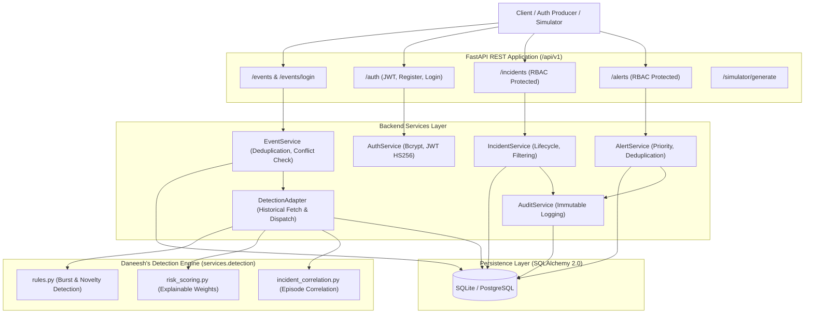

# Sentinel System Architecture & Integration Guide

**Platform:** Sentinel — AI-Powered Identity Threat Detection Platform  
**Authors:** Person A (Daneesh — Detection Engine) & Person B (Tanish — Backend Integration)  
**Version:** 1.0.0  

---

## 1. System Overview

Sentinel monitors authentication activity in real time, ingests structured login events, evaluates threats using deterministic rules and heuristic risk scoring, correlates multi-stage attack episodes into actionable security incidents, and dispatches prioritized alerts to security analysts via protected REST APIs.



---

## 2. Database Schema & Models

The relational schema is implemented with SQLAlchemy 2.0 ORM:

1. **`users`**:
   - `id`: Primary key (`usr-...`)
   - `username`: String(64), unique, indexed
   - `email`: String(255), unique, nullable
   - `password_hash`: String(255) (Bcrypt salted hash)
   - `role`: String(32) (`admin`, `analyst`, `viewer`)
   - `account_status`: String(32) (`active`, `suspended`, `disabled`)
   - `created_at`, `updated_at`: UTC timestamps

2. **`login_events`**:
   - `event_id`: Primary key (1–128 chars)
   - `user_id`: String(256), indexed
   - `timestamp`: DateTime (UTC timezone-aware), indexed
   - `event_type`: String(32) (`LOGIN_SUCCESS`, `LOGIN_FAILURE`)
   - `source`: String(64)
   - `ip_address`: String(45), nullable, indexed
   - `device_id`: String(256), nullable, indexed
   - `failure_reason`: String(256), nullable
   - `payload_hash`: String(64) (SHA-256 canonical hash for conflict checking)
   - `raw_payload`: JSON
   - `detection_status`: String(32) (`pending`, `evaluated`, `failed`)
   - `detection_result`: JSON (structured detection envelope)
   - Compound indexes: `(user_id, timestamp)`, `(user_id, event_type, timestamp)`

3. **`incidents`**:
   - `incident_id`: Primary key (`inc-...` SHA-256 hash)
   - `title`, `description`: Text
   - `user_id`: String(256), indexed
   - `incident_type`: String(128)
   - `risk_score`: Integer (0–100)
   - `severity`: String(32) (`LOW`, `MEDIUM`, `HIGH`, `CRITICAL`)
   - `status`: String(32) (`open`, `investigating`, `resolved`, `false_positive`)
   - `start_time`, `end_time`: DateTime (UTC aware)
   - `signals`, `explanations`: JSON arrays
   - `scorer_version`: String(32)
   - Relationship: `events` (via `incident_events`), `alerts` (cascade delete)

4. **`incident_events`** (Junction Table):
   - `incident_id`: Foreign key $\to$ `incidents.incident_id`
   - `event_id`: Foreign key $\to$ `login_events.event_id`

5. **`alerts`**:
   - `alert_id`: Primary key (`alt-...`)
   - `incident_id`: Foreign key $\to$ `incidents.incident_id`
   - `alert_type`, `severity`: String
   - `message`: Text
   - `is_acknowledged`: Boolean, indexed
   - `acknowledged_by`: String, nullable
   - `acknowledged_at`: DateTime, nullable

6. **`audit_logs`**:
   - `id`: Integer primary key (autoincrement)
   - `actor`: String(256), indexed
   - `action`: String(128)
   - `resource_type`, `resource_id`: String
   - `timestamp`: DateTime (UTC)
   - `details`: JSON

---

## 3. REST API Endpoint Reference

### Authentication (`/api/v1/auth`)
| Method | Path | Auth / Role | Description |
|---|---|---|---|
| `POST` | `/api/v1/auth/register` | Public | Register user account |
| `POST` | `/api/v1/auth/login` | Public | Obtain Bearer JWT token |
| `GET` | `/api/v1/auth/me` | Bearer Token | View current user profile |
| `GET` | `/api/v1/auth/users` | `admin` | List registered users |

### Ingestion & Events (`/api/v1/events` and root `/events`)
| Method | Path | Auth / Role | Description |
|---|---|---|---|
| `POST` | `/events` & `/api/v1/events` | Public | Canonical v1 ingestion with strict idempotency |
| `POST` | `/api/v1/events/login` | Public | Convenience login ingestion format |
| `GET` | `/api/v1/events` | `viewer`+ | List events with filtering & pagination |
| `GET` | `/api/v1/events/{id}` | `viewer`+ | Retrieve event by ID |

### Incident Management (`/api/v1/incidents`)
| Method | Path | Auth / Role | Description |
|---|---|---|---|
| `GET` | `/api/v1/incidents` | `viewer`+ | Query incidents (filters: `severity`, `user_id`, `status`, `min_risk_score`) |
| `GET` | `/api/v1/incidents/{id}` | `viewer`+ | Incident detail with contributing event trace |
| `PATCH`| `/api/v1/incidents/{id}` | `analyst`, `admin` | Update investigation status & notes |

### Alert Management (`/api/v1/alerts`)
| Method | Path | Auth / Role | Description |
|---|---|---|---|
| `GET` | `/api/v1/alerts` | `viewer`+ | List alerts ordered by priority & status |
| `GET` | `/api/v1/alerts/{id}` | `viewer`+ | Alert detail with linked incident |
| `PATCH`| `/api/v1/alerts/{id}` | `analyst`, `admin` | Acknowledge alert |

### Simulator (`/api/v1/simulator`)
| Method | Path | Auth / Role | Description |
|---|---|---|---|
| `POST` | `/api/v1/simulator/generate` | Public | Generate synthetic test scenarios (`failed_login_burst`, `normal_activity`, `unfamiliar_device`, `unfamiliar_ip`) |

---

## 4. Setup & Running Instructions

### Prerequisites
- Python 3.10+
- Dependencies: `fastapi`, `uvicorn`, `sqlalchemy`, `pydantic`, `pydantic-settings`, `bcrypt`, `pyjwt`, `httpx`, `pytest`

### Environment Configuration
Copy `.env.example` to `.env`:
```bash
cp .env.example .env
```
Default configuration uses local SQLite:
```env
DATABASE_URL=sqlite:///./sentinel.db
SECRET_KEY=generate-a-secure-random-key-for-production
```

### Running the API Server
Start the development server with Uvicorn:
```bash
uvicorn backend.main:app --reload --host 0.0.0.0 --port 8000
```
- Interactive API documentation (Swagger UI): `http://localhost:8000/docs`
- ReDoc documentation: `http://localhost:8000/redoc`

### Running Tests
Execute the full test suite (Person A + Person B):
```bash
pytest Sentinel -o pythonpath=Sentinel
```

---

## 5. Measured Performance & Benchmarks

Benchmarked using 30 rapid sequential event ingestion requests with in-memory SQLite:
- **Throughput:** ~134.3 events/second
- **Average Response Time:** ~7.45 ms/event (including payload validation, atomic database transaction, historical index lookup, detection rule execution, and response serialization).

---

## 6. Known Limitations & Future Work

1. **In-Process Synchronous Detection:** Currently, detection runs synchronously during event ingestion. For high-volume multi-tenant production systems exceeding thousands of events per second, an asynchronous message queue (e.g. RabbitMQ or Redis Streams) with an ordered worker consumer is recommended.
2. **Behavioral Baseline Longevity:** Novelty detection evaluates all historical successes for that user. In massive production databases with millions of rows per user, a rolling baseline summary table (e.g. `user_known_devices` and `user_known_ips`) would further optimize query overhead.
